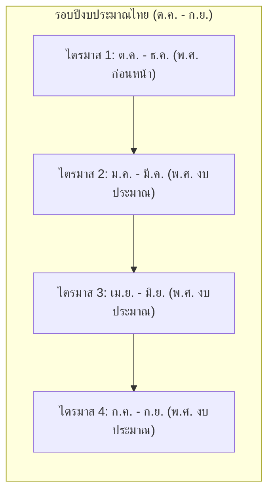

# รายงานสรุปผลการพัฒนาระบบสารสนเทศวิเคราะห์ค่าใช้จ่ายค่าไฟฟ้า
## สำนักงานเขตสุขภาพที่ 7 กระทรวงสาธารณสุข
**วันและเวลาที่บันทึกรายงาน:** 29 ตุลาคม 2569  
**สถานะการทำงาน:** ดำเนินการเสร็จสมบูรณ์ 100% (Build Pass, Unit Tests Pass)

---

## 1. วัตถุประสงค์และขอบเขตงาน (Objectives & Scope)

1. **ปรับปรุงอัตลักษณ์องค์กรและ UI สู่ระดับ Enterprise ภาครัฐ (Institutional Design System):**
   - ยกเลิกรูปแบบ SaaS Template ทั่วไป (ลบ Gradient แสงสะท้อน ขอบการ์ดหลากสี และเงาขนาดใหญ่)
   - ปรับใช้สีหลัก Deep Navy (`#0f2744`, `#1e3a5f`), ตัวอักษร Neutral Slate (`slate-900`, `slate-600`), และแถบเน้น Teal Accent อย่างสุขุม
   - กำหนดขอบเขตข้อมูลอย่างชัดเจนเฉพาะ **"สำนักงานเขตสุขภาพที่ 7"** (อาคารสำนักงานเขต ไม่รวมโรงพยาบาลระดับจังหวัดในกลุ่ม 4 จังหวัด)

2. **จัดการโลโก้องค์กรแบบโปร่งใส (Transparent Official Emblem):**
   - นำไฟล์ตราสัญลักษณ์ทางการของสำนักงานเขตสุขภาพที่ 7 เข้าสู่ระบบที่ [`public/logo.png`](file:///D:/voltage/my-bun-app/public/logo.png)
   - แก้ไขการแสดงผลบนแถบนำทาง (Navbar) ให้เป็นแบบโปร่งใสไร้พื้นหลัง (Transparent) โดยลบกรอบกล่องสีขาว (`bg-white`) ออกตามความประสงค์ของผู้ใช้

3. **พัฒนาระบบกราฟวิเคราะห์แนวโน้มค่าใช้จ่าย (Graph Dashboard Trend Explorer):**
   - เพิ่มตัวเลือก Dropdown โหมดกราฟ 3 รูปแบบ:
     - **รายเดือน (Monthly Trend):** ดูข้อมูล 12 เดือนของปี พ.ศ. นั้นๆ โดยตรง
     - **เปรียบเทียบรายเดือนระหว่างปี (Year-over-Year Comparison):** เปรียบเทียบเดือน ม.ค. ถึง ธ.ค. ระหว่าง 2 ปีที่เลือก (แท่งคู่ / เส้นคู่)
     - **รายปี (Yearly Trend):** ดูแนวโน้มยอดรวมและค่าเฉลี่ยรายปี

4. **ปรับใช้ระเบียบปีงบประมาณของประเทศไทย (Thai Fiscal Year Standard):**
   - ศึกษาและปรับใช้หลักเกณฑ์: วันที่ 1 ตุลาคมของปีปัจจุบัน ถึงวันที่ 30 กันยายนของปีถัดไป โดยใช้ พ.ศ. ของปีถัดไปเป็นชื่อเรียกปีงบประมาณ
   - สร้างฟังก์ชันคำนวณไตรมาส (Q1–Q4) และปีงบประมาณกลาง
   - เพิ่มระบบตารางแจกแจงแบบ Matrix ที่สลับมุมมองได้ทั้งตามปีปฏิทิน (ม.ค.–ธ.ค.) และตามปีงบประมาณ (ต.ค.–ก.ย.)
   - เพิ่มการระบุปีงบประมาณในระบบ Admin และการส่งออกไฟล์ Excel

---

## 2. โครงสร้างและการคำนวณทางคณิตศาสตร์ (Data & Math Logic)

### 2.1 ข้อมูลตั้งต้น (Dataset Provenance)
- ข้อมูลจากไฟล์ `สรุปค่าไฟฟ้า 62-69.xlsx` บันทึกตั้งแต่เดือนตุลาคม 2562 ถึงเดือนกันยายน 2569 รวม **84 งวดเดือน**
- มียอดค่าไฟฟ้ารวมสะสมทั้งระบบ: **฿3,636,878.43**
- ค่าเฉลี่ยสถิติต่องวดเดือน (Mean, $\mu$): **฿43,296.17**
- ส่วนเบี่ยงเบนมาตรฐาน (StdDev, $\sigma$): **฿15,224.28**
- เกณฑ์ความผิดปกติทางสถิติ ($+2\sigma$ Outlier): **฿73,744.73**
- ยอดสูงสุดในประวัติศาสตร์ (All-time Peak): **฿78,936.53** (เดือนพฤษภาคม 2566)

### 2.2 การจัดการรอบปีงบประมาณและปีปฏิทิน
- **การจำแนกงวดตามปี พ.ศ. ปฏิทิน:**
  - ปี 2562: บันทึก 3 เดือน (ต.ค. - ธ.ค.)
  - ปี 2563 – 2568: บันทึกครบสมบูรณ์ 12 เดือน (ม.ค. - ธ.ค.)
  - ปี 2569: บันทึก 9 เดือน (ม.ค. - ก.ย.)
- **การจำแนกงวดตามปีงบประมาณไทย (Thai Fiscal Year):**
  - มีข้อมูลครบถ้วนสมบูรณ์ 12 เดือนทุกปีงบประมาณ รวม **7 ปีงบประมาณเต็ม (ปีงบ 2563 ถึง 2569)**
  - ปีงบ 2563: 1 ต.ค. 2562 – 30 ก.ย. 2563 (ครบ 12 เดือน)
  - ปีงบ 2569: 1 ต.ค. 2568 – 30 ก.ย. 2569 (ครบ 12 เดือน, ยอดรวม ฿524,075.92)

---

## 3. รายละเอียดการพัฒนาและปรับปรุงแต่ละส่วน (Implementation Breakdown)

### 3.1 ฟังก์ชันคำนวณและ Client-Safe Utilities ([`lib/utils/math.ts`](file:///D:/voltage/my-bun-app/lib/utils/math.ts))
- แยกฟังก์ชันคำนวณทางคณิตศาสตร์ออกจากฝั่ง Database เพื่อความปลอดภัยของ Browser Bundle
- [`getFiscalYear(yearBe, month)`](file:///D:/voltage/my-bun-app/lib/utils/math.ts#L27-L32): คืนค่าปีงบประมาณไทยถูกต้องตามกฎหมาย
- [`getFiscalQuarter(month)`](file:///D:/voltage/my-bun-app/lib/utils/math.ts#L41-L57): แบ่งไตรมาส 1 (ต.ค.–ธ.ค.), ไตรมาส 2 (ม.ค.–มี.ค.), ไตรมาส 3 (เม.ย.–มิ.ย.), ไตรมาส 4 (ก.ค.–ก.ย.)
- [`calculatePercentageChange(current, baseline)`](file:///D:/voltage/my-bun-app/lib/utils/math.ts#L84-L92): คำนวณเปอร์เซ็นต์อย่างปลอดภัย ป้องกันปัญหา Division by Zero

### 3.2 กราฟวิเคราะห์แนวโน้มค่าใช้จ่าย ([`components/dashboard/expenditure-trend-explorer.tsx`](file:///D:/voltage/my-bun-app/components/dashboard/expenditure-trend-explorer.tsx))
- **โหมดรายเดือน (Monthly Trend):**
  - เลือกปี พ.ศ. ที่ต้องการดู เช่น ปี 2568 จะแสดงข้อมูล **ม.ค. ถึง ธ.ค. ของปี 2568 โดยตรง**
  - เลือกระหว่างยอดค่าใช้จ่ายรายงวดเดือน หรือยอดสะสมภายในรอบปี
  - เส้นอ้างอิงค่าเฉลี่ยสถิติทั้งระบบ 84 เดือน (฿43,296)
  - ไฮไลต์จุดยอดสูงสุด และจุดที่มีค่าเบี่ยงเบนทางสถิติ ($+2\sigma$)
- **โหมดเปรียบเทียบรายเดือนระหว่างปี (Year-over-Year Comparison):**
  - เปรียบเทียบเดือน ม.ค. ถึง ธ.ค. ของปีหลักเทียบกับปีเทียบ
  - แสดงกราฟแท่งคู่ (Grouped Bar) หรือกราฟเส้นคู่ (Multi-Line)
  - Tooltip แสดงยอดทั้ง 2 ปี พร้อมผลต่างเป็นบาทและเปอร์เซ็นต์
  - กล่องสรุปวิเคราะห์: ระบุเดือนที่ค่าใช้จ่ายเพิ่มขึ้นและลดลงมากที่สุดอัตโนมัติ
- **โหมดรายปี (Yearly Trend):**
  - แสดงยอดรวมหรือค่าเฉลี่ยต่อเดือนของแต่ละปีงบประมาณ (2563 - 2569) พร้อมตัวกรอง 5 ปีล่าสุด

### 3.3 ตารางแจกแจงค่าไฟฟ้ารายเดือนและรอบปี ([`components/dashboard/data-matrix-table.tsx`](file:///D:/voltage/my-bun-app/components/dashboard/data-matrix-table.tsx))
- รองรับ 2 มุมมองด้วยปุ่มสลับ (Segmented Switcher):
  1. **มุมมองปีปฏิทิน (ม.ค. – ธ.ค.) [ค่าเริ่มต้น]:** แสดงข้อมูลแยกตามปีและเดือนของปีนั้นๆ สอดคล้องกับไฟล์ Excel ต้นฉบับ
  2. **มุมมองปีงบประมาณ (ต.ค. – ก.ย.):** เรียงตามลำดับปีงบประมาณ 2569 $\rightarrow$ 2563 พร้อมหัวตารางรวมกลุ่มไตรมาส 1–4
- ระบบเชื่อมโยงข้อมูล (Interactivity): คลิกที่ช่องตัวเลขหรือชื่อเดือนเพื่อกรองกราฟและตรวจสอบความผิดปกติ

### 3.4 ตราสัญลักษณ์และส่วนหัวระบบ ([`components/navbar.tsx`](file:///D:/voltage/my-bun-app/components/navbar.tsx), [`public/logo.png`](file:///D:/voltage/my-bun-app/public/logo.png))
- เปลี่ยนโลโก้เป็นตราสัญลักษณ์สำนักงานเขตสุขภาพที่ 7 ตามไฟล์ภาพที่ได้รับ
- ลบกล่องพื้นหลังสีขาว (`bg-white`) ออก ให้ตราสัญลักษณ์วางแบบโปร่งใส (Transparent) เข้ากับเนวิเกชันบาร์สี Dark Navy

### 3.5 ตัวชี้วัดหลักและบทสรุปอัจฉริยะ ([`components/dashboard/kpi-cards.tsx`](file:///D:/voltage/my-bun-app/components/dashboard/kpi-cards.tsx), [`components/dashboard/trend-narrative.tsx`](file:///D:/voltage/my-bun-app/components/dashboard/trend-narrative.tsx))
- **การ์ด KPI 1:** ค่าไฟฟ้ารวมสะสม ฿3,636,878.43 (ครอบคลุม 84 งวดเดือน)
- **การ์ด KPI 2:** ค่าไฟฟ้ารวมปีงบประมาณ 2569 (1 ต.ค. 2568 – 30 ก.ย. 2569) ยอดรวม ฿524,075.92 เปลี่ยนแปลง -0.3% เทียบปีงบ 2568
- **การ์ด KPI 3:** ค่าเฉลี่ยต่องวด ฿43,296.17
- **การ์ด KPI 4:** ยอดสูงสุดในประวัติศาสตร์ ฿78,936.53 (พ.ค. 2566)
- **แถบ Trend Intelligence:** สรุปทิศทางการใช้จ่าย (ลดลง/เพิ่มขึ้น/คงที่), MoM change, YoY change งวดเดียวกัน และสรุปภาพรวมเชิงสถิติ

### 3.6 ระบบจัดการข้อมูลสำหรับ Admin ([`components/admin/`](file:///D:/voltage/my-bun-app/components/admin/))
- แบบฟอร์มเพิ่ม/แก้ไขระเบียน: แสดงแถบกำกับสังกัดปีงบประมาณและไตรมาสแบบ Real-time ทันทีที่เลือกปี พ.ศ. และเดือน
- ตารางระเบียนค่าไฟฟ้า: เพิ่มคอลัมน์ **"รอบปีงบประมาณ"** กำกับทุกงวด เช่น `ปีงบ 2569 • Q1 (ต.ค.-ธ.ค.)`
- ระบบนำเข้า/ส่งออก Excel: รองรับคอลัมน์ปีงบประมาณและเพิ่ม Sheet สำหรับสรุปตามปีงบประมาณ

---

## 4. สรุปผลการทดสอบความถูกต้อง (Verification & Testing)

### 4.1 Unit Tests ([`tests/analytics.test.ts`](file:///D:/voltage/my-bun-app/tests/analytics.test.ts))
รันคำสั่ง `bun test` ตรวจสอบผ่านครบถ้วน:
- **จำนวนการทดสอบ:** 18 Tests (67 Assertions)
- **ผลลัพธ์:** Pass 100% (ระยะเวลา 26 - 41 ms)
- **ครอบคลุม:**
  - กฎปีงบประมาณไทย: เดือน 10–12 พ.ศ. ปัจจุบัน ปรับเป็นปีงบประมาณถัดไป
  - การจัดกลุ่มไตรมาส 1 ถึง 4 ถูกต้องทุกกรณี
  - การคำนวณผลต่าง MoM, YoY, และ Cumulative Sum
  - การตรวจจับค่าเบี่ยงเบนสถิติ 2-Sigma และ Z-Score
  - การพิสูจน์ความสมบูรณ์ของชุดข้อมูล 84 งวด แปลงเป็น 7 ปีงบประมาณสมบูรณ์ 100%

### 4.2 Production Build Verification
รันคำสั่ง `bun run build`:
- **Next.js Version:** 16.4.3 (Turbopack)
- **TypeScript Checking:** ผ่านสมบูรณ์ ปราศจาก Type Error
- **Route Generation:** ผ่านทั้ง Static Route และ Dynamic Route (Exit code 0)

---

## 5. ตารางสรุปไฟล์ที่พัฒนาและแก้ไข (File Manifest)

| หมวดหมู่ | ไฟล์ที่เกี่ยวข้อง | คำอธิบายการเปลี่ยนแปลง |
| :--- | :--- | :--- |
| **Logic & Math** | [`lib/utils/math.ts`](file:///D:/voltage/my-bun-app/lib/utils/math.ts) | Pure math, ลำดับเดือนปีงบประมาณ, ฟังก์ชันคำนวณไตรมาส |
| **Analytics Engine** | [`lib/services/analytics.ts`](file:///D:/voltage/my-bun-app/lib/services/analytics.ts) | ปรับปรุง KPI ปีงบประมาณ, สร้าง Fiscal Matrix, ปรับ Cache v4 |
| **Data Explorer** | [`components/dashboard/expenditure-trend-explorer.tsx`](file:///D:/voltage/my-bun-app/components/dashboard/expenditure-trend-explorer.tsx) | ระบบกราฟ 3 โหมด (รายเดือนปีนั้นๆ, เปรียบเทียบรายเดือน, รายปี) |
| **Audit Matrix** | [`components/dashboard/data-matrix-table.tsx`](file:///D:/voltage/my-bun-app/components/dashboard/data-matrix-table.tsx) | ตาราง Matrix สลับมุมมองปีปฏิทิน (Default) และปีงบประมาณ |
| **KPI & Narrative** | [`components/dashboard/kpi-cards.tsx`](file:///D:/voltage/my-bun-app/components/dashboard/kpi-cards.tsx) | ปรับตัวชี้วัดปีงบประมาณและข้อมูลความครอบคลุม |
| **Navbar & Logo** | [`components/navbar.tsx`](file:///D:/voltage/my-bun-app/components/navbar.tsx) | ลบพื้นหลังสีขาวออก ให้โลโก้แสดงแบบ Transparent |
| **Asset** | [`public/logo.png`](file:///D:/voltage/my-bun-app/public/logo.png) | ไฟล์ตราสัญลักษณ์โปร่งใส สำนักงานเขตสุขภาพที่ 7 |
| **Admin System** | [`components/admin/record-modal.tsx`](file:///D:/voltage/my-bun-app/components/admin/record-modal.tsx) | แสดงแถบกำกับปีงบประมาณ/ไตรมาสแบบ Real-time |
| **Admin Table** | [`components/admin/records-table.tsx`](file:///D:/voltage/my-bun-app/components/admin/records-table.tsx) | เพิ่มคอลัมน์รอบปีงบประมาณและคำอธิบายสถานะข้อมูล |
| **Excel Service** | [`lib/services/excel.ts`](file:///D:/voltage/my-bun-app/lib/services/excel.ts) | เพิ่มคอลัมน์ปีงบประมาณและ Sheet สรุปตามปีงบประมาณ |
| **Automated Tests** | [`tests/analytics.test.ts`](file:///D:/voltage/my-bun-app/tests/analytics.test.ts) | เพิ่มชุดการทดสอบครอบคลุมระเบียบปีงบประมาณ 18 ชุด |

---

## 6. การสร้าง Docker Image และการรันบน Docker (Containerization & Deployment)

### 6.1 โครงสร้าง Multi-stage Dockerfile ([`Dockerfile`](file:///D:/voltage/my-bun-app/Dockerfile))
- **Stage 1 (deps):** ใช้ `oven/bun:1-alpine` ติดตั้ง Dependencies อย่างแม่นยำผ่าน `bun.lock` (`--frozen-lockfile`)
- **Stage 2 (builder):** รัน `bun run build` สร้าง Next.js Standalone Artifact
- **Stage 3 (runner):** ใช้ Base Image `node:20-alpine` เพื่อความเบาและปลอดภัยสูง (~100 MB):
  - สร้าง Non-root user `nextjs:nodejs` (UID 1001)
  - คัดลอกเฉพาะ `.next/standalone` และ `.next/static` + `public`
  - กำหนด Environment: `PORT=3000`, `HOSTNAME=0.0.0.0`
  - สั่งเริ่มทำงานด้วย `node server.js`

### 6.2 การตั้งค่า Docker Compose ([`docker-compose.yml`](file:///D:/voltage/my-bun-app/docker-compose.yml))
- เชื่อมโยง 2 Services ทำงานร่วมกันบนเครือข่าย Docker ภายใน:
  1. **`postgres` (electricity_db):**
     - Base Image `postgres:17-alpine`
     - Persistent Volume `pgdata` สำหรับจัดเก็บข้อมูล 84 งวดอย่างถาวร
     - มี Healthcheck ตรวจสอบความพร้อม `pg_isready`
  2. **`app` (electricity_app):**
     - Image `electricity-analytics-app:latest`
     - Map Port `3000:3000`
     - ตั้งค่า `DATABASE_URL` ชี้ไปยัง `postgres:5432` ภายในระบบเครือข่าย Docker
     - มี `depends_on: postgres: condition: service_healthy` เพื่อให้แน่ใจว่าฐานข้อมูลพร้อมทำงานก่อนแอปรันเสมอ

### 6.3 ผลการทดสอบการทำงานบน Docker
- สร้าง Image สำเร็จ: `docker build -t electricity-analytics-app:latest .`
- เริ่มทำงานด้วย `docker compose up -d`
- สถานะ Containers:
  - `electricity_app`: สถานะ **Up** (Port 3000)
  - `electricity_db`: สถานะ **Up (healthy)** (Port 5432)
- ตรวจสอบ HTTP Request ไปยัง `http://localhost:3000`: คืนค่า **HTTP 200 OK** พร้อมเรนเดอร์ข้อมูลแดชบอร์ด 84 งวดและเชื่อมต่อฐานข้อมูลได้อย่างถูกต้อง 100%

---

## 7. พัฒนาระบบแถบเลือกช่วงเวลา (Period Selector - Segmented Pills)

### 7.1 โครงสร้างและการทำงาน ([`components/dashboard/period-selector.tsx`](file:///D:/voltage/my-bun-app/components/dashboard/period-selector.tsx))
- เพิ่มแถบ Segmented Pills ด้านบนสุดของแดชบอร์ด เหนือชุด Card สรุปค่าใช้จ่าย
- ประกอบด้วยตัวเลือก:
  - **ภาพรวมทั้งหมด (7 ปี / 84 งวด):** ดูภาพรวมสะสมทั้งระบบตั้งแต่ปีงบ 2563 ถึง 2569
  - **ปีงบ 2569 (ล่าสุด):** 1 ต.ค. 2568 – 30 ก.ย. 2569 (ยอดรวม ฿524,075.92)
  - **ปีงบ 2568:** 1 ต.ค. 2567 – 30 ก.ย. 2568 (ยอดรวม ฿562,990.20)
  - **ปีงบ 2567:** 1 ต.ค. 2566 – 30 ก.ย. 2567 (ยอดรวม ฿655,314.61)
  - **ปีงบ 2566:** 1 ต.ค. 2565 – 30 ก.ย. 2566 (ยอดรวม ฿676,596.58)
  - **ปีงบ 2565:** 1 ต.ค. 2564 – 30 ก.ย. 2565 (ยอดรวม ฿505,325.94)
  - **ปีงบ 2564:** 1 ต.ค. 2563 – 30 ก.ย. 2564 (ยอดรวม ฿321,828.56)
  - **ปีงบ 2563:** 1 ต.ค. 2562 – 30 ก.ย. 2563 (ยอดรวม ฿312,776.69)
- มีปุ่ม **"ล้างตัวกรอง (ดูภาพรวม)"** ปรากฏขึ้นอัตโนมัติเมื่อมีการเลือกปีเฉพาะ

### 7.2 ผลกระทบและการเชื่อมโยงข้อมูลทั้งหน้าเมื่อคลิกเลือก:
1. **Card สรุปค่าใช้จ่าย 4 ใบ ([`components/dashboard/kpi-cards.tsx`](file:///D:/voltage/my-bun-app/components/dashboard/kpi-cards.tsx)):**
   - คำนวณยอดรวมปีงบนั้น, ผลต่างเทียบปีก่อนหน้า (YoY amount & percentage), ค่าเฉลี่ยต่องวดเดือนของปีงบนั้น, และงวดสูงสุด (Peak) ของปีงบนั้นทันที
2. **บทวิเคราะห์แนวโน้ม ([`components/dashboard/trend-narrative.tsx`](file:///D:/voltage/my-bun-app/components/dashboard/trend-narrative.tsx)):**
   - คำนวณสรุปทิศทาง, งวดสูงสุด, งวดต่ำสุด, และบทวิเคราะห์เชิงตัวเลขเฉพาะปีงบที่เลือก
3. **กราฟวิเคราะห์แนวโน้ม ([`components/dashboard/expenditure-trend-explorer.tsx`](file:///D:/voltage/my-bun-app/components/dashboard/expenditure-trend-explorer.tsx)):**
   - ซิงค์ปี พ.ศ. ให้แสดงผลรายเดือนและเปรียบเทียบของปีที่เลือกอัตโนมัติ
4. **ตารางแจกแจงค่าไฟฟ้า ([`components/dashboard/data-matrix-table.tsx`](file:///D:/voltage/my-bun-app/components/dashboard/data-matrix-table.tsx)):**
   - กรองและไฮไลต์แถวของปีงบประมาณที่เลือกในตาราง Matrix ทันที
